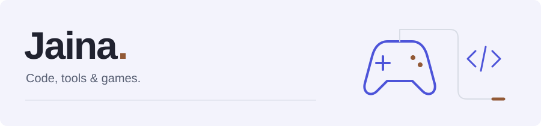

<picture>
  <source media="(prefers-color-scheme: dark)" srcset="assets/header-dark.svg">
  <source media="(prefers-color-scheme: light)" srcset="assets/header-light.svg">
  
</picture>

Hi, I'm Jaina, a developer from Argentina. I build Minecraft plugins, desktop apps, and Discord bots. Games and their communities are a big part of my public projects.

## Selected work

**[JiferCraft Launcher](https://github.com/JainaGam3r45/jifercraft-launcher)**  
A Minecraft desktop launcher built with Electron, React, and TypeScript. It handles Microsoft sign-in, version selection, and game settings like memory allocation and Java paths.

**[KotlinPluginCore](https://github.com/JainaGam3r45/kotlin-plugin-core)**  
I got tired of copying the same setup into every PaperMC plugin, so I put it in one project. This is my Kotlin starting point, with modules, configuration helpers, and Brigadier commands already wired up.

**[AinBot](https://github.com/JainaGam3r45/AinBot)**  
This one goes back to 2018. I picked it up again in 2024 as an educational Discord bot project. It uses JavaScript and discord.js, with a configurable command and event system.

## Contributions

I've also contributed to [nonchat](https://github.com/utophii/nonchat), a Minecraft chat plugin maintained by utophii. A couple of my merged PRs:

- [LuckPerms hex color compatibility](https://github.com/utophii/nonchat/pull/52) fixes color parsing and inheritance.
- [Configurable spam detection](https://github.com/utophii/nonchat/pull/31) handles repeated messages, similar messages, and message flooding.

## Tools I work with

Most of these projects use TypeScript or JavaScript, with React and Electron for the launcher and discord.js for AinBot. On the Minecraft side, I work with Java, Kotlin, and PaperMC. I also use Bun across several projects.

---

[JiferCraft](https://www.jifercraft.com/) · [Community on Discord](https://discord.jifercraft.com/)

Feel free to look around. English or español, either works.
